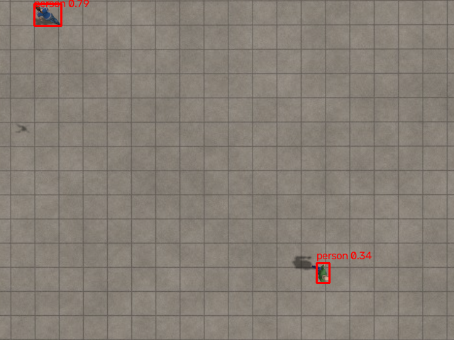
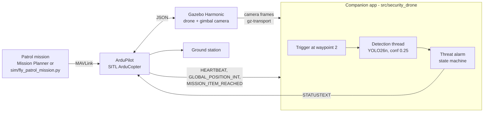
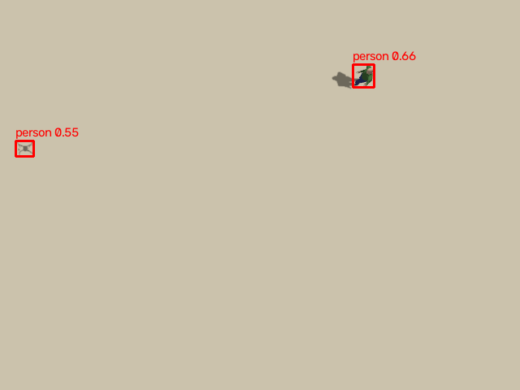
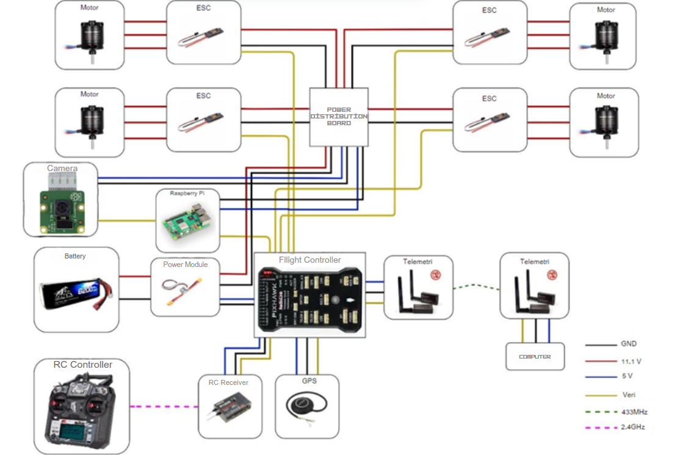

# Autonomous Security Drone

An autonomous drone that flies a pre-planned patrol mission, starts looking for people when it reaches the protected area, and sends a threat alert with position and time to the ground station.

The flight controller runs ArduPilot; a companion computer listens to it over MAVLink, runs a YOLO person detector on the downward camera and raises a non-blocking alarm.



*Gazebo, 15 m altitude, fine-tuned YOLO26n. Both people are found; the drone's own shadow (left) is not.*

> **Background.** This was my TÜBİTAK 2209-A supported undergraduate graduation project. The hardware tests were done in 2025 with a Pixhawk and a Raspberry Pi 5. The drone, the original companion script and the original trained model are no longer available, so in 2026 I rebuilt the system in simulation (ArduPilot SITL + Gazebo Harmonic) and retrained the detector. Everything below the "Original hardware" section was built and measured in simulation.

## How it works



1. The mission follows the thesis: take off to 15 m, fly to the protected area 60 m north (waypoint 2), then fly square laps over it. The camera sees ~26 x 19.5 m from 15 m; laps 5 m off the centre keep the centre in view on every leg and each edge of the 20 x 20 m area on at least one.
2. When ArduPilot reports `MISSION_ITEM_REACHED` for the trigger waypoint, the companion starts a detection thread on the camera feed and a patrol timer.
3. Detections go through a queue to the main thread, which owns the MAVLink link. The alarm turns on at the first person, repeats every 10 s while people are seen, and clears 3 s after the last one.
4. Each alert is a `STATUSTEXT` from the companion's own component id, e.g. `Threat: 2 person at -35.36272,149.16524 04:08:36Z`, which the autopilot forwards to the ground station.
5. When the patrol time is up, the companion sends RTL and checks that the autopilot accepted it (thesis: the Raspberry Pi sends RTL when the mission time ends). The 6 min come from the battery: the thesis estimates ~10 min of flight on the 6200 mAh pack, and the flight out, the return and landing take ~1.5 min. A ground station can end the patrol earlier by switching to RTL or LAND. The Pixhawk's own battery failsafe and a final RTL after a fixed number of laps are the backups.
6. Detection stops when the patrol ends, ready for the next flight after landing.

## Results

### Person detector

The original COCO `yolov8n.pt` is trained mostly on ground-level photos and barely finds people seen from above. I fine-tuned on [VisDrone2019-DET](https://github.com/VisDrone/VisDrone-Dataset) (drone images; `pedestrian` + `people` merged into one `person` class), then added Gazebo "hard negatives" (below). All models: 50 epochs, 1280 px, Colab L4. Scored on VisDrone **test-dev** (1,610 real drone images, never used in training), person class only:

| Model | mAP50 @640 | mAP50 @1280 | Recall @1280 | Params |
|---|---|---|---|---|
| YOLOv8n, COCO weights | 0.075 | 0.176 | 0.183 | 3.2 M |
| YOLOv8n + VisDrone | 0.240 | 0.438 | 0.405 | 3.0 M |
| YOLOv8n + VisDrone + negatives | 0.237 | 0.437 | 0.406 | 3.0 M |
| YOLO11n + VisDrone + negatives | 0.246 | 0.440 | 0.407 | 2.6 M |
| **YOLO26n + VisDrone + negatives** (used) | **0.266** | **0.455** | **0.420** | 2.5 M |

Fine-tuning more than doubles mAP; the fine-tuned model at 640 px beats the COCO model at 1280 px with a quarter of the computation. Full tables: [`docs/results/`](docs/results).

### The drone mistook its own shadow for a person



The first VisDrone model raised alarms over empty ground: it boxed the drone's own X-shaped shadow (left) as a person, during the hover, on turns and on landing. VisDrone has no images of a drone's shadow, so the model had never learned that it is not a person. A real drone casts one too.

Fix: fly Gazebo missions in a world with nobody in it (several sun angles, 6-25 m, a textured urban world with vehicles, trees and street furniture) and add the frames as empty-label training images. [`training/select_negatives.py`](training/select_negatives.py) kept every frame either model boxed something in plus every 4th other frame: 506 images, ~18% backgrounds overall.

| Frames with a false positive, held-out sun angle (220 frames) | |
|---|---|
| YOLOv8n COCO | 4.5% |
| YOLOv8n + VisDrone | 15.5% |
| any model + VisDrone + negatives | **0%** |

Test-dev mAP stayed the same. The cost showed up in a held-out Gazebo flight: the YOLOv8n negatives model found the *second* of two people in fewer frames, especially people with long shadows. YOLO11n and YOLO26n trained the same way kept more of them, which together with test-dev and equal speed is why YOLO26n is the default ([threshold sweep](docs/results/threshold_sweep.csv)).

### A real photo as the ground

A generated ground texture is easy for a detector. The orthophoto world (`--world ortho`) uses a real 4 cm/px drone orthophoto as the ground: a park and a parking lot in Split, Croatia ("Perivoj Ane Roje", [OpenAerialMap](https://openaerialmap.org), CC-BY 4.0, WebODM / om1s186, 2022). [`sim/make_ortho_ground.py`](sim/make_ortho_ground.py) downloads it and rotates it so that the park is 60 m north of the lot, and the Gazebo sun matches the photo's shadows.

A flight with the 3D people removed, over the lot, a school roof and yard, houses, a road with parked cars and the park, 8-20 m, 299 frames. The photo turned out to contain one real pedestrian, a dark figure ~0.35 m across on a shaded road, in view in ~5 frames. Every box was sorted into "the pedestrian" or "false positive" by [`training/split_photo_person.py`](training/split_photo_person.py) and then checked by eye:

| conf 0.25 | Frames with the real pedestrian | Frames with a false positive |
|---|---|---|
| YOLOv8n, COCO weights | 0 | 19.7% |
| YOLOv8n + VisDrone | 4 | 10.4% |
| YOLOv8n + VisDrone + negatives | 4 | 0.7% |
| YOLO11n + VisDrone + negatives | 4 | 0% |
| YOLO26n + VisDrone + negatives (used) | 0 | 0% |

At conf 0.4 the false-positive rates are 14.7%, 3.3%, 0%, 0% and 0% ([full table](docs/results/ortho_negatives.csv)).

- The COCO model boxed parked cars and their shadows seen from above, and never the pedestrian.
- The VisDrone model without negatives boxed a light patch in the grass, a white object on a sandy yard, a dark gap at a roof edge and, over the grey area outside the photo, the drone's own shadow again.
- The hard negatives were all synthetic Gazebo frames, yet on real photo texture they cut false-positive frames from 10% to under 1%.
- YOLO26n, the default model, raised no false alarm but also missed the real pedestrian: its best score for it was 0.21, under the 0.25 threshold. YOLO11n found it in 4 frames at 0.57-0.61, again without false positives. On an earlier flight over the same photo YOLO26n did box the pedestrian (2 frames, 0.32) and a dark roof gap (1 frame). One pedestrian in one photo is too little to rank the models, but it matches the Gazebo hover, where YOLO11n also found more of the hard-to-see people.
- The ground is a stitched orthomosaic at 4 cm/px, blurrier than a live camera: a Camera Module 3 at 15 m, fed to the detector at 1280 px, sees ~2 cm/px, and stitching smears moving people and leans buildings. The absolute rates are likely pessimistic; the comparison between models on the same frames is the useful part.

### End-to-end flight (urban world, YOLO26n)

[`sim/fly_companion_patrol.sh`](sim/fly_companion_patrol.sh) runs Gazebo, SITL, the companion and the mission unattended. Patrol flight, with the patrol time shortened to 2 min for the test:

- first alert 0.6 s after reaching the trigger waypoint;
- 597 frames over five laps; a person in 58% of them (the camera moves, so people leave the frame), never more than 6 s without a detection, mean confidence 0.63;
- after 120 s the companion sent RTL, the autopilot accepted it, and the drone flew home, landed and disarmed;
- ~63 ms per frame at 1280 px on a GTX 1650 Ti.

An earlier hover test over the same spot (`fly_patrol_mission.py --hover 10`) found a person in 99 of 99 frames (mean confidence 0.77) and nothing on the return leg or landing (vehicles, fire hydrant, lamp posts, own shadow).

### CPU speed (a stand-in for the Raspberry Pi)

The Pi is not available, so latency was measured on a laptop CPU (Intel i5-10300H) pinned to 4 cores like a Pi 5, preprocessing + inference + postprocessing per frame ([`training/benchmark_cpu.py`](training/benchmark_cpu.py)):

| YOLO26n | 640 px | 960 px | 1280 px |
|---|---|---|---|
| PyTorch | 108 ms | 155 ms | 213 ms |
| NCNN | 71 ms | 164 ms | 317 ms |

YOLOv8n, YOLO11n and YOLO26n were within ~7% of each other at every size, despite 8.2 / 6.5 / 5.9 GFLOPs. These are relative numbers: a Pi 5 is several times slower, and NCNN is tuned for ARM, so the Pi has to be measured on the Pi. On the Pi the detector would run at 640 px, where the fine-tuned model still beats COCO at 1280.

## Engineering notes

Things that went wrong or were not what I expected, and what I changed:

- **Trigger on takeoff.** The thesis started detection at `seq == 1`, which in a mission that begins with TAKEOFF is the takeoff itself. The trigger waypoint is now configurable (`trigger_seq: 2`).
- **Commands that silently fail.** After the default 10 s disarm delay, TAKEOFF returned `MAV_RESULT_FAILED`. Every command now checks `COMMAND_ACK.result` instead of assuming success.
- **Talking to the wrong component.** pymavlink left `target_component` at 0, and the autopilot forwards the ground station's heartbeats between links, so the companion could lock onto the ground station instead of the autopilot. `connect()` now waits for the autopilot's own heartbeat and sets the target component.
- **A hold time delays the waypoint event.** With a hold time on the waypoint itself, `MISSION_ITEM_REACHED` only arrives when the hold ends. The hover is a separate `LOITER_TIME` item.
- **A command item shifted the waypoint event.** With a `DO_CHANGE_SPEED` right after the trigger waypoint, ArduPilot reported the waypoint's `MISSION_ITEM_REACHED` with the next seq (its own `STATUSTEXT` still said "Reached command #2"), so detection never started and the drone patrolled blind. The trigger waypoint is now followed by a navigation item, and a test checks it.
- **The alarm froze the loop.** The thesis alarm used `sleep()` in the main loop. It is now a non-blocking state machine that also clears itself.
- **Small targets need a large input.** A person is ~45 px tall from 15 m; COCO YOLOv8n found nothing at 640 px and found it at 1280 px.
- **A dataset bug that looked like training.** A symlinked image folder made Ultralytics read the original 10-class labels, mark almost every image "corrupt" and train on nothing, without an error. Images are now hard-linked.
- **Several boxes on one person.** YOLO26n is NMS-free and sometimes puts nested boxes on one person (body, body + shadow), so "1 person" was reported as up to 5. Their IoU is low, so plain NMS would not merge them; [`merge_overlapping()`](src/security_drone/detection/detector.py) drops a box that covers most of a more confident one.
- **I corrected one of my own claims.** A first threshold sweep suggested the negatives model beat the old one on every axis at conf 0.25; it was counting those nested boxes as extra people. After deduplicating and checking on a held-out flight, the claim did not hold, and the table above says what did.
- **A "false positive" was a person.** On the orthophoto flight most boxes of the fine-tuned models were on one small dark object, and I first wrote it off as probably an animal. A second look by eye showed a real pedestrian. Counted correctly, the model with the cleanest record (YOLO26n, 0 false positives) was also the one that missed the only real person. "Person-free" test data needs checking, not assuming.
- **Two texture bugs looked like detector errors.** The photo's ragged dark edge was boxed as people; trimming it with a brightness threshold then blanked dark shadows inside the photo with grey patches, whose edges were boxed too. No-data is now only the black area connected to the image border.

## Running it

Tested on Windows 11 + WSL2 Ubuntu 22.04 with an NVIDIA GPU. Needs [ArduPilot SITL](https://ardupilot.org/dev/docs/building-setup-linux.html) in `~/ardupilot`, [Gazebo Harmonic](https://gazebosim.org/docs/harmonic/install_ubuntu) and the [`ardupilot_gazebo`](https://github.com/ArduPilot/ardupilot_gazebo) plugin built in `~/ardupilot_gazebo`.

```bash
python3 -m venv --system-site-packages ~/venvs/security-drone   # system packages for the gz bindings
~/venvs/security-drone/bin/pip install -r requirements.txt
~/venvs/security-drone/bin/pip install -e .
~/venvs/security-drone/bin/python -m pytest -q
```

The trained weights are not in git. Download `yolo26n_visdrone_person_neg.pt` from the [Releases](https://github.com/cihankarat4s/autonomous-security-drone/releases) page into the repository root, or train it with [`training/colab_train.ipynb`](training/colab_train.ipynb). To use the COCO weights instead, set `detection.model: yolov8n.pt` and `detection.confidence: 0.4` in [`config/default.yaml`](config/default.yaml).

One command, unattended (`urban`, `ortho` or `flat` world, optional patrol time in seconds):

```bash
bash sim/fly_companion_patrol.sh demo urban 120
```

Or step by step, one terminal each, in this order:

```bash
bash sim/run_gazebo.sh --world urban      # or --world ortho; drop --world for the flat world; --headless for no GUI
bash sim/run_sitl.sh                      # SITL + MAVProxy
~/venvs/security-drone/bin/python -m security_drone.main   # companion, TCP 5762
~/venvs/security-drone/bin/python sim/fly_patrol_mission.py  # uploads and flies the patrol, TCP 5763
```

Mission Planner on Windows can listen on UDP 14550 to watch the flight and the threat messages.

## Repository structure

```
src/security_drone/   companion app: MAVLink link, trigger, camera, detector, alarm
config/default.yaml   connection, trigger waypoint, model, threshold, alarm timing
sim/                  Gazebo worlds, launch scripts, missions, data collection
training/             VisDrone preparation, Colab training, evaluation, benchmarks
tests/                unit tests (no GPU or simulator needed)
docs/results/         all measured results as CSV
media/images/         figures used in this README
```

## Limitations

- Everything after 2025 was tested in simulation only. The Gazebo people and shadows are rendered, not real, and the hard negatives are synthetic.
- No measurement on a Raspberry Pi; the CPU numbers are from a laptop.
- I have no aerial footage of my own, so the real-image tests are VisDrone test-dev and one orthophoto used as Gazebo ground. On that photo the people in the patrol are rendered 3D models; the only real person is one pedestrian seen in ~5 frames.

## Original hardware (2025)

1. A mission planned in Mission Planner was flown by a Pixhawk running ArduPilot.
2. A Raspberry Pi 5 on TELEM2 listened over MAVLink and started detection at the surveillance waypoint.
3. Frames from a Camera Module 3 NoIR were enhanced (histogram equalisation, sharpening) and passed to YOLOv8n.
4. On a detection, a buzzer sounded and a `STATUSTEXT` was sent to the ground station; the drone returned with RTL.



*The diagram does not show the buzzer or the MINI560 step-down regulator that powered the Raspberry Pi; both were on the drone.*

**Hardware:** Pixhawk, Raspberry Pi 5 (8 GB), Camera Module 3 NoIR, GPS, 3DR 433 MHz telemetry, FlySky FS-i6X with receiver, 3S 6200 mAh Li-Po, MINI560 step-down regulator, buzzer.

Earlier 2024 prototypes (DroneKit flight helpers, OpenCV STOP-sign and face tracking) are in the initial commit `dbd549e`.

## Safety

The flight code is experimental and has only been run in SITL. Validate everything in simulation before any real hardware.
